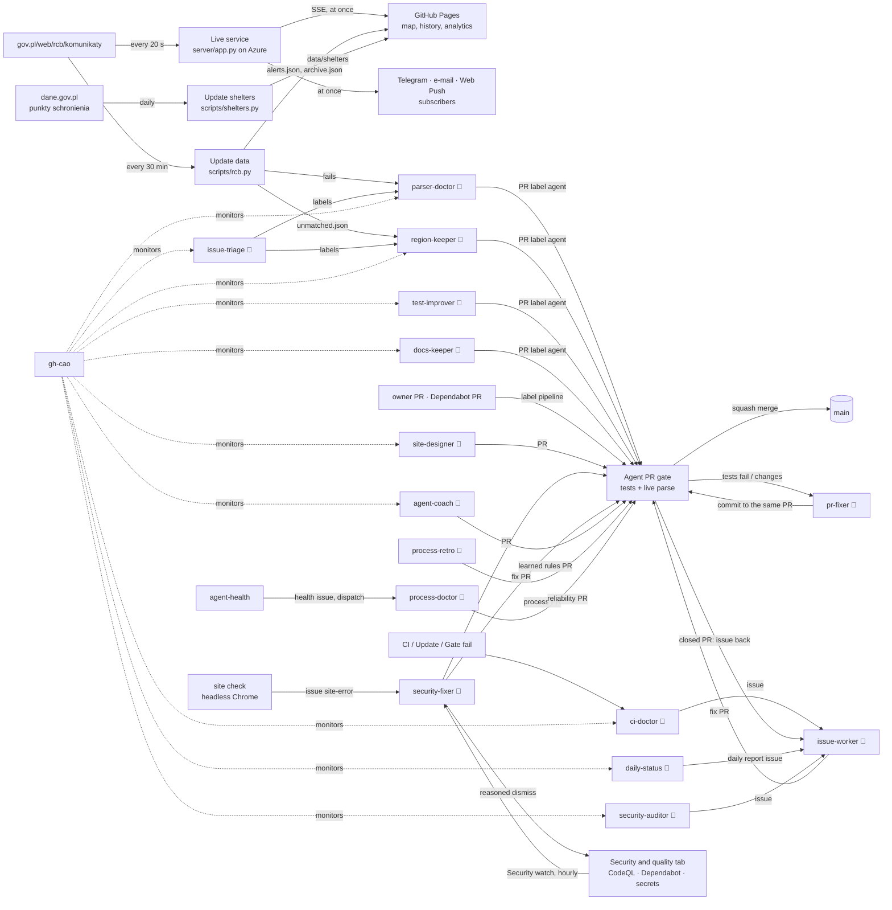

# alerty-pl — mapa Alertów RCB

**https://casper-assistant-ai.github.io/alerty-pl/**

A live map of Poland with the current alerts of the Government Centre for Security
(Rządowe Centrum Bezpieczeństwa), in the spirit of [alerts.in.ua](https://alerts.in.ua/).
Source: [gov.pl/web/rcb/komunikaty](https://www.gov.pl/web/rcb/komunikaty). Unofficial;
the official channel is the RCB alert SMS.

**Languages.** Every page speaks Polish, English and Ukrainian: the PL / EN / UK switcher in the
header, or `?lang=pl|en|uk` in any address. The choice is kept for the next visit; a first visit
follows the browser's languages and falls back to Polish. The texts live in `docs/i18n.js` (shared)
and `docs/i18n-<page>.js`, the same keys in all three (`tests/i18n.test.mjs`). Alert messages from
RCB, the shelter records and place names stay as published, in Polish; the changelog shows the
commit messages as written, in English. Site check and the mobile audit open every page in all three.

The map zooms down to a street. It shows any day or period since 2021: two handles over the
histogram of alerts, quick buttons (24 h, 7 dni, 30 dni, rok, wszystko), two dates and ◀ ▶ that
shift the period by its length (`?od=2026-10-24&do=2026-11-22`; the old `?dzien=` still opens one
day). The map, the counts and the lists cover the whole period. Under the alerts lies a street
map, Esri World Imagery Wayback (it switches to the newest image of the visible area taken on or
before the period's end), or NASA's true-colour picture of its last day (`&podklad=esri|nasa`).
NASA FIRMS fires of that day can go on top (`&pozary=1`).
The address bar keeps the place and the zoom (`?srodek=50.565,17.965&zoom=15`) and a chosen Esri
image (`&zdjecie=2025-04-24`), so a link opens the same view. The
[Porównaj](https://casper-assistant-ai.github.io/alerty-pl/porownaj.html?srodek=50.5650,17.9650&zoom=15&lewa=2025-03-27&prawa=2025-04-24)
page puts two Esri images of one place side by side, for example the Odra near Opole before and
during the September 2024 flood; moving or zooming one map moves the other.

The [Schrony](https://casper-assistant-ai.github.io/alerty-pl/schrony.html) page maps about 88 000
shelter points from the State Fire Service's open data
([dane.gov.pl](https://dane.gov.pl/pl/dataset/28058,punkty-schronienia-w-polsce), CC BY 4.0, refreshed
daily). Give it your location, an address or a tap on the map, and it lists the nearest shelters with
the distance and a «Nawiguj» button that opens the phone's map apps (Apple Maps, Google Maps, Waze, or
the Android chooser).

This repository is also a demo of **an autonomous engineering team**: after the first commit, the
site is run, repaired, tested and documented by [GitHub Agentic Workflows](https://github.github.com/gh-aw/)
in the style of [Peli's Agent Factory](https://github.github.com/gh-aw/blog/2026-01-12-welcome-to-pelis-agent-factory/),
with no human in the loop, and watched with [gh-cao](https://github.com/githubnext/gh-cao).

## How it works



## The team

| Workflow | Kind | Model | Trigger | May change |
|---|---|---|---|---|
| live service `server/app.py` | Python (aiohttp), Azure VM | — | polls RCB every 20 s | sends alerts to open pages (SSE), Telegram, e-mail and Web Push; deployed from `main` within 2 min |
| `update.yml` | plain Actions | — | every 30 min | `docs/data/` (fallback and archive), release tag, `CHANGELOG.md`, Pages |
| `site-check.yml` | plain Actions, headless Chrome | — | hourly and after each deploy | issue `site-error`, dispatches `site-fixer` |
| `ci.yml` | plain Actions | — | push, PR | nothing |
| `agent-pr-gate.yml` | plain Actions | — | twice an hour, after the reviewer and the fixer | merges agent, owner and Dependabot PRs that pass, sends broken ones to `pr-fixer` |
| `agent-dispatch.yml` | plain Actions | — | daily | nothing; starts the extra agent runs planned in `process/schedule.json` |
| `workflow-maintainer.yml` | plain Actions | — | every 30 min, after the process-doctor | lands `workflow-change` issues: applies the patch, compiles, guards permissions, network, tools, steps, scripts and secrets, tests, pushes with the deploy key (prompt text after the PR reviewer approves it; a `run:` script goes to Casper, label `needs-casper`), closes the issue |
| `agent-health.yml` | plain Actions | — | after every agent run, twice an hour | one self-closing `[aw] <agent>: N failed runs in a row` issue per failing agent; dispatches `process-doctor` for a new one |
| `pr-reviewer` | agent | GLM-5.4 (z.ai) | when the gate asks | verdict PR review: approve, changes or reject |
| `pr-fixer` | agent | GLM-5.4 (z.ai) | when the gate asks (3 attempts a PR) | a commit to the PR's own branch |
| `issue-worker` | agent | GLM-5.4 (z.ai) | every 2 h, on each new issue, when the CI doctor, the gate or the process-retro dispatches it | fix PR (`Closes #N`) or closes the issue; takes a `dev-task` at once; improvement PR from `process/improvements.md` |
| `parser-doctor` | agent | GLM-5.4 (z.ai) | daily + when Update fails | PR: `scripts/`, `tests/` |
| `region-keeper` | agent | GLM-5.4 (z.ai) | daily | PR: `scripts/`, `tests/` |
| `test-improver` | agent | GLM-5.4 (z.ai) | weekly | PR: `tests/` |
| `docs-keeper` | agent | GLM-5.4 (z.ai) | weekly | PR: `README.md`, `AGENTS.md` |
| `site-fixer` | agent | GLM-5.4 (z.ai) | on a site-check issue, daily | PR: `docs/*.html\|js\|css`, `scripts/`, `tests/` |
| `site-designer` | agent + skills unslop, modern-web-guidance | GLM-5.4 (z.ai) | weekly | PR: `docs/*.html\|js\|css` |
| `security-auditor` | agent + skill security-audit | GLM-5.4 (z.ai) | weekly | issue |
| `security-fixer` | agent | GLM-5.4 (z.ai) | when Security watch (hourly, plain code) sees an alert no PR or issue covers; weekly | fix PR (`Alerts: code-scanning#N`), reasoned dismiss, or an issue for Casper (leaked secret, `server/`) |
| `agent-coach` | agent + skill skillopt-sleep | GLM-5.4 (z.ai) | weekly | PR: learned rules in `AGENTS.md` |
| `process-retro` | agent | GLM-5.4 (z.ai) | daily | PR: the Process block in `AGENTS.md`, `process/**`; opens `dev-task` issues and dispatches the issue-worker for them |
| `process-doctor` | agent | GLM-5.4 (z.ai) | on each new agent-health issue (at most every 2 h), daily | PR: the Reliability rules block in `AGENTS.md`, `process/failure-patterns.md`, `process/improvements.md`; `workflow-change` issues with the patch for `.github/workflows`; comments on and closes agent-tooling issues |
| `ci-doctor` | agent | GLM-5.4 (z.ai) | a failed run on main | issue |
| `issue-triage` | agent | GLM-5.4 (z.ai) | every 12 h | labels, comments |
| `daily-status` | agent | GLM-5.4 (z.ai) | daily | report issue |

All 17 agents run Claude Code against z.ai's Anthropic-compatible API
(`engine: claude`, `model: glm-5.4`, `ANTHROPIC_BASE_URL`, secret `ANTHROPIC_API_KEY`; shared
settings in `.github/workflows/shared/zai.md`). They load the
[TokenEconomizer](https://github.com/microsoft/TokenEconomizer) plugin for cost control. Skills come
pinned by commit through gh-aw `skills:`:
[unslop](https://github.com/heydamir/unslop),
[modern-web-guidance](https://github.com/GoogleChrome/modern-web-guidance),
[security-audit](https://github.com/cloudflare/security-audit-skill) and
[skillopt-sleep](https://github.com/microsoft/skillopt).
The watchers and the reporter (ci-doctor, issue-triage, daily-status) moved from GitHub Copilot
to GLM-5.4 on 23.11.2026, so the whole team runs on one model.

Guard rails: agents run read-only and write only through gh-aw safe outputs; each PR is limited to
its `allowed-files`; `.github/` is protected; public issues never start an agent (triage runs on a
schedule); the gate merges only when unit tests and a live parse of gov.pl pass and the reviewer approves; a
broken PR is fixed in its own branch by `pr-fixer` (three attempts) before the gate gives up on it.

The owner's own PRs (authors `kloba` and `casper-assistant-ai`, once marked ready) and Dependabot's
PRs go through the same pipeline: the gate labels them `pipeline`, `pr-reviewer` gives its verdict,
`pr-fixer` repairs them in their branch, and the gate merges them. A Dependabot PR may change only
`server/requirements*.txt`; an owner PR may change anything except `.github/workflows/`, which the
gate's token cannot merge. A PR that touches `server/` must also install and start the live
service. The gate never closes an owner PR: it comments «Agent PR gate: stopped» with the reason
and adds the label `gate-stopped`; remove the label to hand the PR back to the gate.

## Live alerts and notifications

`server/app.py` is the main path for new alerts. It reads the RCB list every 20 seconds with the
site's own parser (`scripts/rcb.py`) and sends each new alert, update or cancellation at once:

- to every open page of the site, over Server-Sent Events (`/alerty/events`; a toast and a fresh map);
- to the subscribers chosen on the [Powiadomienia](https://casper-assistant-ai.github.io/alerty-pl/powiadomienia.html)
  page, filtered by voivodeship: the Telegram bot, e-mail (double opt-in, Azure Communication
  Services) and Web Push (VAPID, `docs/sw.js`).

It runs on the `alerty-cao` VM at `https://alerty-pl-cao.polandcentral.cloudapp.azure.com/alerty/`
(`/health`, `/alerts`, `/events`, `/config`), set up by `deploy/alerty-api` in the private
casper-infra repository. A timer there follows `main` every 2 minutes: when `server/`, `scripts/` or
`docs/geo/` change it reinstalls, checks the import and `/health`, and returns to the previous commit
if either fails. If the service is down, the pages fall back to `docs/data/`.

Run it locally: `pip install -r server/requirements.txt`, then
`STATE_DIR=/tmp/alerty PORT=8090 python3 server/app.py`, and in the browser console
`localStorage.setItem("alerty-api", "http://127.0.0.1:8090")`. Add `?test` to a page URL to see
test alerts.

## Run locally

```sh
python3 -I -m unittest discover -s tests
python3 -I scripts/rcb.py update --pages 3      # writes docs/data/
python3 -I scripts/rcb.py update --pages 120 --keep-going   # backfill the archive since 2021
python3 -I scripts/shelters.py update          # shelter points into docs/data/shelters/
python3 -m http.server -d docs 8000
```

## Monitor the agents

```sh
gh extension install githubnext/gh-cao
gh cao dashboard --repo casper-assistant-ai/alerty-pl   # needs Docker or Podman
gh aw status && gh aw logs --start-date -1d
```

Map data: [ppatrzyk/polska-geojson](https://github.com/ppatrzyk/polska-geojson) (MIT); gmina names: GUGiK PRG. Map: [Leaflet](https://leafletjs.com) (BSD-2, vendored). Layers, all without keys: Esri Light/Dark Gray Canvas, [Esri World Imagery Wayback](https://livingatlas.arcgis.com/wayback/), [NASA GIBS](https://www.earthdata.nasa.gov/gibs) true colour and [NASA FIRMS](https://firms.modaps.eosdis.nasa.gov/) VIIRS 375 m fires. Code: MIT.

## Versions and changelog

Commits follow [Conventional Commits](https://www.conventionalcommits.org); CI checks them.
Each Update data run tags a new [semver](https://semver.org) version when main has releasable
commits (`feat` → minor, `fix`/`perf` → patch, `!` → major) and rebuilds `CHANGELOG.md` and the
[Zmiany](https://casper-assistant-ai.github.io/alerty-pl/zmiany.html) page from them.
