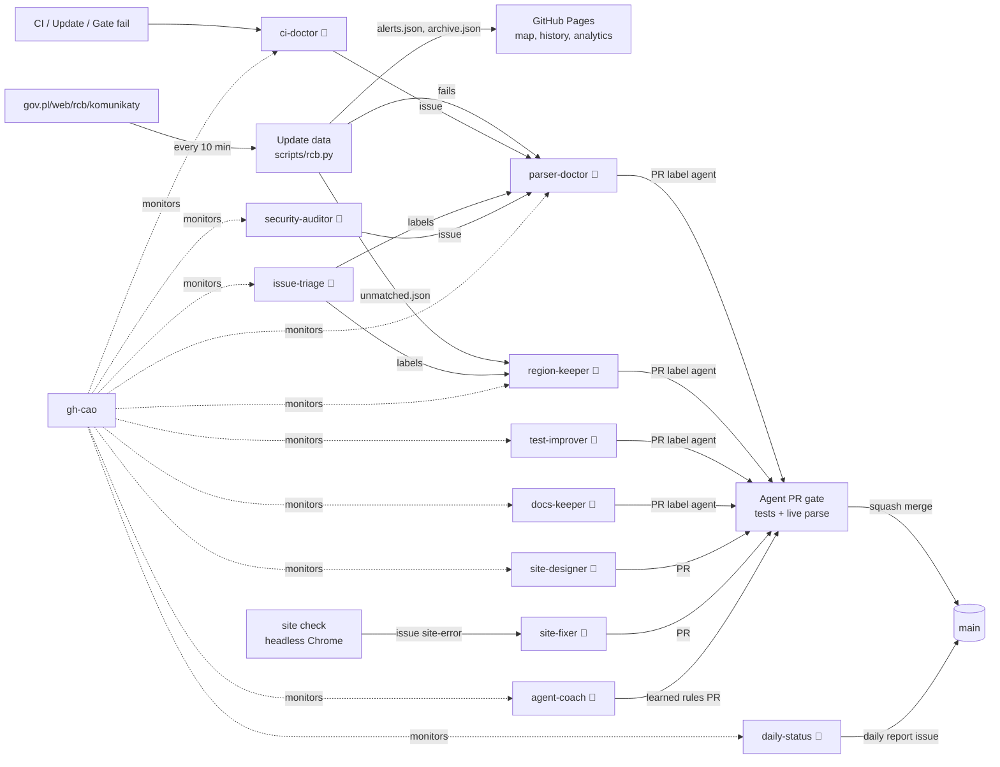

# alerty-pl — mapa Alertów RCB

**https://casper-assistant-ai.github.io/alerty-pl/**

A live map of Poland with the current alerts of the Government Centre for Security
(Rządowe Centrum Bezpieczeństwa), in the spirit of [alerts.in.ua](https://alerts.in.ua/).
Source: [gov.pl/web/rcb/komunikaty](https://www.gov.pl/web/rcb/komunikaty). Unofficial;
the official channel is the RCB alert SMS.

The map zooms down to a street. A day slider goes back to any day since 2021
(`?dzien=2026-11-20`). Under the alerts lies a street map, Esri World Imagery Wayback with
every imagery date of the visible area, or NASA's true-colour picture of that day
(`&podklad=esri|nasa`). NASA FIRMS fires of that day can go on top (`&pozary=1`).

This repository is also a demo of **an autonomous engineering team**: after the first commit, the
site is run, repaired, tested and documented by [GitHub Agentic Workflows](https://github.github.com/gh-aw/)
in the style of [Peli's Agent Factory](https://github.github.com/gh-aw/blog/2026-01-12-welcome-to-pelis-agent-factory/),
with no human in the loop, and watched with [gh-cao](https://github.com/githubnext/gh-cao).

## How it works



## The team

| Workflow | Kind | Model | Trigger | May change |
|---|---|---|---|---|
| `update.yml` | plain Actions | — | every 10 min | `docs/data/`, release tag, `CHANGELOG.md`, Pages |
| `site-check.yml` | plain Actions, headless Chrome | — | hourly and after each deploy | issue `site-error`, dispatches `site-fixer` |
| `ci.yml` | plain Actions | — | push, PR | nothing |
| `agent-pr-gate.yml` | plain Actions | — | twice an hour | merges agent PRs that pass |
| `parser-doctor` | agent | GLM-5.3 (z.ai) | daily + when Update fails | PR: `scripts/`, `tests/` |
| `region-keeper` | agent | GLM-5.3 (z.ai) | daily | PR: `scripts/`, `tests/` |
| `test-improver` | agent | GLM-5.3 (z.ai) | weekly | PR: `tests/` |
| `docs-keeper` | agent | GLM-5.3 (z.ai) | weekly | PR: `README.md`, `AGENTS.md` |
| `site-fixer` | agent | GLM-5.3 (z.ai) | on a site-check issue, daily | PR: `docs/*.html\|js\|css`, `scripts/`, `tests/` |
| `site-designer` | agent + skills unslop, modern-web-guidance | GLM-5.3 (z.ai) | weekly | PR: `docs/*.html\|js\|css` |
| `security-auditor` | agent + skill security-audit | GLM-5.3 (z.ai) | weekly | issue |
| `agent-coach` | agent + skill skillopt-sleep | GLM-5.3 (z.ai) | weekly | PR: learned rules in `AGENTS.md` |
| `ci-doctor` | agent | Copilot | a failed run on main | issue |
| `issue-triage` | agent | Copilot | every 12 h | labels, comments |
| `daily-status` | agent | Copilot | daily | report issue |

The developer agents run Claude Code against z.ai's Anthropic-compatible API
(`engine: claude`, `model: glm-5.3`, `ANTHROPIC_BASE_URL`, secret `ANTHROPIC_API_KEY`; shared
settings in `.github/workflows/shared/zai.md`). They load the
[TokenEconomizer](https://github.com/microsoft/TokenEconomizer) plugin for cost control. Skills come
pinned by commit through gh-aw `skills:`:
[unslop](https://github.com/heydamir/unslop),
[modern-web-guidance](https://github.com/GoogleChrome/modern-web-guidance),
[security-audit](https://github.com/cloudflare/security-audit-skill) and
[skillopt-sleep](https://github.com/microsoft/skillopt).
Watchers and reporters stay on GitHub Copilot.

Guard rails: agents run read-only and write only through gh-aw safe outputs; each PR is limited to
its `allowed-files`; `.github/` is protected; public issues never start an agent (triage runs on a
schedule); the gate merges only when unit tests and a live parse of gov.pl pass.

## Run locally

```sh
python3 -I -m unittest discover -s tests
python3 -I scripts/rcb.py update --pages 3      # writes docs/data/
python3 -I scripts/rcb.py update --pages 120 --keep-going   # backfill the archive since 2021
python3 -m http.server -d docs 8000
```

## Monitor the agents

```sh
gh extension install githubnext/gh-cao
gh cao dashboard --repo casper-assistant-ai/alerty-pl   # needs Docker or Podman
gh aw status && gh aw logs --start-date -1d
```

Map data: [ppatrzyk/polska-geojson](https://github.com/ppatrzyk/polska-geojson) (MIT). Map: [Leaflet](https://leafletjs.com) (BSD-2, vendored). Layers, all without keys: Esri Light/Dark Gray Canvas, [Esri World Imagery Wayback](https://livingatlas.arcgis.com/wayback/), [NASA GIBS](https://www.earthdata.nasa.gov/gibs) true colour and [NASA FIRMS](https://firms.modaps.eosdis.nasa.gov/) VIIRS 375 m fires. Code: MIT.

## Versions and changelog

Commits follow [Conventional Commits](https://www.conventionalcommits.org); CI checks them.
Each Update data run tags a new [semver](https://semver.org) version when main has releasable
commits (`feat` → minor, `fix`/`perf` → patch, `!` → major) and rebuilds `CHANGELOG.md` and the
[Zmiany](https://casper-assistant-ai.github.io/alerty-pl/zmiany.html) page from them.
