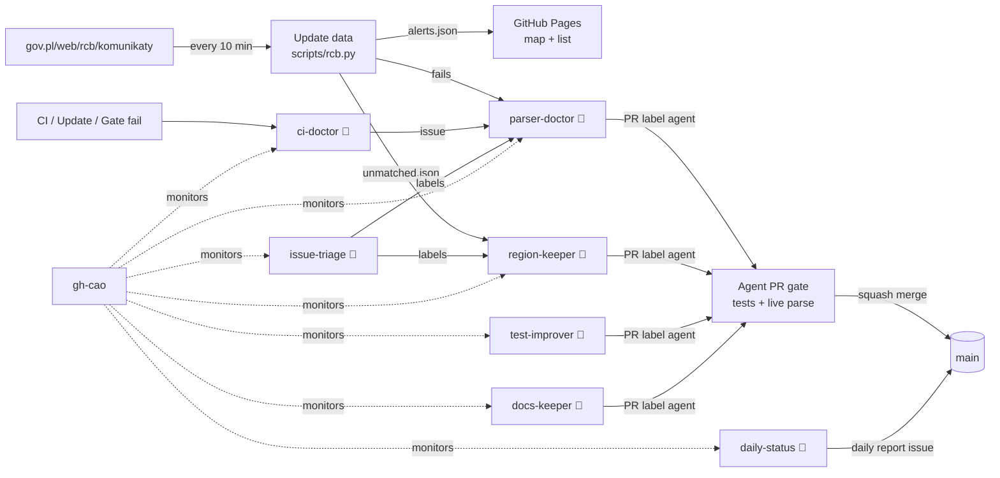

# alerty-pl — mapa Alertów RCB

**https://casper-assistant-ai.github.io/alerty-pl/**

A live map of Poland with the current alerts of the Government Centre for Security
(Rządowe Centrum Bezpieczeństwa), in the spirit of [alerts.in.ua](https://alerts.in.ua/).
Source: [gov.pl/web/rcb/komunikaty](https://www.gov.pl/web/rcb/komunikaty). Unofficial;
the official channel is the RCB alert SMS.

This repository is also a demo of **an autonomous engineering team**: after the first commit, the
site is run, repaired, tested and documented by [GitHub Agentic Workflows](https://github.github.com/gh-aw/)
in the style of [Peli's Agent Factory](https://github.github.com/gh-aw/blog/2026-01-12-welcome-to-pelis-agent-factory/),
with no human in the loop, and watched with [gh-cao](https://github.com/githubnext/gh-cao).

## How it works



## The team

| Workflow | Kind | Trigger | May change |
|---|---|---|---|
| `update.yml` | plain Actions | every 10 min | `docs/data/`, Pages |
| `ci.yml` | plain Actions | push, PR | nothing |
| `agent-pr-gate.yml` | plain Actions | twice an hour | merges agent PRs that pass |
| `parser-doctor` | agent | daily + when Update fails | PR: `scripts/`, `tests/` |
| `region-keeper` | agent | daily | PR: `scripts/`, `tests/` |
| `ci-doctor` | agent | a failed run on main | issue |
| `issue-triage` | agent | every 12 h | labels, comments |
| `test-improver` | agent | weekly | PR: `tests/` |
| `docs-keeper` | agent | weekly | PR: `README.md`, `AGENTS.md` |
| `daily-status` | agent | daily | report issue |

Guard rails: agents run read-only and write only through gh-aw safe outputs; each PR is limited to
its `allowed-files`; `.github/` is protected; public issues never start an agent (triage runs on a
schedule); the gate merges only when unit tests and a live parse of gov.pl pass.

## Run locally

```sh
python3 -I -m unittest discover -s tests
python3 -I scripts/rcb.py update --pages 3      # writes docs/data/
python3 -m http.server -d docs 8000
```

## Monitor the agents

```sh
gh extension install githubnext/gh-cao
gh cao dashboard --repo casper-assistant-ai/alerty-pl   # needs Docker or Podman
gh aw status && gh aw logs --start-date -1d
```

Map data: [ppatrzyk/polska-geojson](https://github.com/ppatrzyk/polska-geojson) (MIT). Code: MIT.
