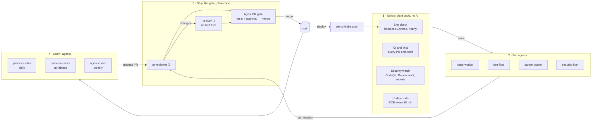

# alerty-pl: a live alert map, run by a team of AI agents

**Site: [alerty.klioba.com](https://alerty.klioba.com)** ·
**Workshop slides: [WAW Tech 2026, «Your Autonomous Engineering Team»](talks/wawtech-2026/)**

alerty-pl is two things at once:

1. **A public site.** A live map of Poland with the alerts of the Government Centre for Security
   ([RCB](https://www.gov.pl/web/rcb/komunikaty)), in the spirit of [alerts.in.ua](https://alerts.in.ua/):
   the alerts in force now, their history since 2021, a map of shelters with the nearest ones to you,
   and notifications by Telegram, e-mail or browser push, in Polish, English and Ukrainian.
   Unofficial; the official channel is the RCB alert SMS.
2. **A demo of an autonomous engineering team.** After the first commit, the site is built, repaired,
   tested, reviewed, merged, deployed and documented by
   [GitHub Agentic Workflows](https://github.github.com/gh-aw/) (gh-aw), with no human in the loop.
   It is [Peli's Agent Factory](https://github.github.com/gh-aw/blog/2026-01-12-welcome-to-pelis-agent-factory/),
   scaled down to one repository.

If you came here after the workshop, the second part is the point. This page explains how the team works
and how to start one for your own project.

## The idea

The project did not start with a request for a site. It started with a request for the team that builds one:

> Build an autonomous team of agents and workflows that will build, improve and maintain a site
> like `<site>`, but for `<country>`. Use `<repo>` as the reference.

For alerty-pl, `<site>` is alerts.in.ua and `<country>` is Poland. The agents built the site, and they
still improve and maintain it. People set the direction and own what ships; the agents do the daily work.

## How the factory works

The loop has four parts. Plain code notices a problem, an agent fixes it, a deterministic gate decides
what ships, and a daily retro improves the process itself.



### The team

| Role | Agents | What they do |
|---|---|---|
| Plan | `issue-triage`, `process-retro`, `process-doctor`, `agent-coach` | label incoming issues, run the daily retro, fix the causes of failing runs, turn repeated mistakes into rules |
| Code | `issue-worker`, `site-designer`, `region-keeper`, `parser-doctor` | turn issues into pull requests, improve the design, keep the place names and the RCB parser right |
| Build and test | `pr-reviewer`, `pr-fixer`, `test-improver`, `ci-doctor` | review every PR, repair it in its own branch, add tests, explain a red run |
| Operate | `site-fixer`, `security-fixer`, `security-auditor`, `docs-keeper`, `daily-status` | repair the live site, close security alerts, audit the code, keep the docs true, write the daily report |

Each agent is one Markdown file in [`.github/workflows/`](.github/workflows/): a short frontmatter
(when it runs, what it may write) and the job in plain English. `gh aw compile` turns it into a normal
GitHub Actions workflow. Plain-code workflows around them (site check, CI, the gate, data updates, deploys)
do everything that needs no judgment. Two files in that folder are not team members: `optimization.md` and
`optimization-token-optimizer.md` (with `shared/` and `.github/cao/`) are gh-cao's Optimization campaign
([`optimization/`](optimization/)), an hourly audit that reads the agents' runs and opens an issue with a
recommendation to save tokens; it changes no code.

### Why you can trust it

- **Least access.** Agents run read-only, without secrets. They write only through gh-aw *safe outputs*:
  one issue, one comment, or one pull request limited to the files their role may touch.
- **A deterministic gate.** An agent judges the PR, but plain code merges it, and only when every check is
  green: unit tests, a live parse of gov.pl, linters and CodeQL.
- **Corrections become checks.** When an agent gets something wrong, the fix is first a test, a lint rule or a
  CodeQL query, so the mistake cannot come back. [`AGENTS.md`](AGENTS.md), the manual every agent reads,
  keeps only what needs judgment.
- **A loop that learns.** Every morning `process-retro` reads the team's runs and changes the process, not
  only the code. Its log is in [`process/`](process/).
- **A way out.** After three failed repairs, the gate closes the PR with the reason. After a second failure,
  the issue closes as `agent-gave-up`, and the next retro splits it into smaller pieces.

### Watching the team

[gh-cao](https://github.com/githubnext/gh-cao) shows every agent run with the PR or issue it made, the tokens
and money each agent spends, what the team shipped, and where it got stuck.

```sh
gh extension install githubnext/gh-cao
gh cao dashboard --repo casper-assistant-ai/alerty-pl   # needs Docker or Podman
```

## Start your own team

1. **Prepare the codebase.** Agents copy what they find: clear names, small modules and good tests are the
   cheapest guardrail. Ask a coding agent to write `AGENTS.md` (how to build and test, the conventions), then
   review that PR like any other.
2. **Install gh-aw** and add one simple agent first, for example a daily status report or issue triage:
   ```sh
   gh extension install github/gh-aw
   gh aw compile        # turns .github/workflows/*.md into Actions workflows
   ```
3. **Copy what you need from here.** The agents in [`.github/workflows/*.md`](.github/workflows/), the
   Agent PR gate ([`agent-pr-gate.yml`](.github/workflows/agent-pr-gate.yml)), `AGENTS.md`, and the retro in
   [`process/`](process/). Most repositories need a handful of agents, not dozens.
4. **Add guardrails before agents.** Let plain code (tests, site checks, security alerts) open the issues, and
   let only the gate merge.
5. **Set budgets.** Tokens add up: check `gh aw logs` and the gh-cao dashboard, and start with fewer schedules.

Fork this repository freely: the code is under the MIT licence.

## Run the site locally

```sh
python3 -I -m unittest discover -s tests          # tests
node --test tests/*.test.mjs                      # the JavaScript tests
python3 -I scripts/rcb.py update --pages 3        # fetch the latest RCB alerts into docs/data/
python3 -m http.server -d docs 8000               # open http://localhost:8000
```

The live alerts and notifications come from a small service in [`server/`](server/). To run it too:
`pip install -r server/requirements.txt`, then `STATE_DIR=/tmp/alerty PORT=8090 python3 server/app.py`,
and in the browser console `localStorage.setItem("alerty-api", "http://127.0.0.1:8090")`.

## Links

- gh-aw documentation: [github.github.com/gh-aw](https://github.github.com/gh-aw/)
- Peli's Agent Factory, the full catalogue of the pattern:
  [github.github.com/gh-aw/blog/2026-01-12-welcome-to-pelis-agent-factory](https://github.github.com/gh-aw/blog/2026-01-12-welcome-to-pelis-agent-factory/)
- gh-cao: [github.com/githubnext/gh-cao](https://github.com/githubnext/gh-cao)
- The talk: [talks/wawtech-2026](talks/wawtech-2026/) · Taras Kloba on LinkedIn: [aka.ms/taras](https://aka.ms/taras)

Data: alerts from [RCB](https://www.gov.pl/web/rcb/komunikaty); shelters from the State Fire Service on
[dane.gov.pl](https://dane.gov.pl/pl/dataset/28058,punkty-schronienia-w-polsce) (CC BY 4.0); map shapes from
[ppatrzyk/polska-geojson](https://github.com/ppatrzyk/polska-geojson) (MIT) and GUGiK PRG; map by
[Leaflet](https://leafletjs.com); imagery from Esri and NASA. Code: [MIT](LICENSE).
